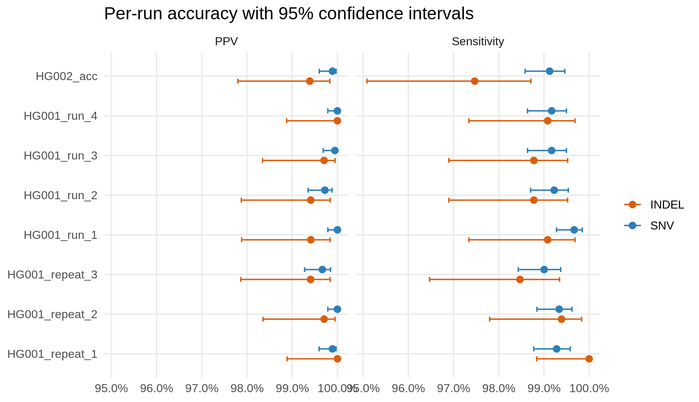

# GermlineQC

[](https://github.com/balajimadhvn/GermlineQC/actions/workflows/ci.yml)


A germline short-variant pipeline written in Nextflow (FASTQ → BWA-MEM → GATK → annotated VCF) together
with the analytical validation a clinical lab needs before it can use one: accuracy against GIAB truth sets,
repeatability, between-run reproducibility and a depth-based limit of detection. Acceptance criteria were
set up front and the results are reported against them, including the one criterion the data did not meet.

```
FASTQ ─ fastp ─ BWA-MEM ─ MarkDuplicates ─ BQSR ─ HaplotypeCaller (GVCF) ─ GenotypeGVCFs
                                   │                                             │
                              mosdepth, samtools                       hard filters + bcftools norm
                                   │                                             │
                              QC gates (PASS/FAIL)                      SnpEff + ClinVar annotation
                                   └───────────────┬─────────────────────────────┘
                                         SQLite variant store, MultiQC
                                                   │
                         validation: RTG vcfeval vs GIAB → Python metrics → R Markdown report
```

## Validation results

15 runs of GIAB reference material (HG001 and HG002, Illumina HiSeq 2500, 2 x 148 bp) over a 1.5 Mb chr20
panel covering the *JAG1* and *GNAS* loci, scored inside GIAB v4.2.1 high-confidence regions.
Full report: [`validation/validation_report.html`](validation/validation_report.html)
(download and open, or view the tables in [`validation/`](validation)).

| Criterion | Observed | 95% CI lower bound | Target | Result |
|---|---|---|---|---|
| SNV sensitivity (8 runs at 30x, 14,493 truth SNVs) | 99.25% | 99.09% | ≥ 99% | PASS |
| SNV PPV | 99.89% | 99.82% | ≥ 99% | PASS |
| Indel sensitivity (2,605 truth indels) | 98.89% | 98.41% | ≥ 95% | PASS |
| Indel PPV | 99.63% | 99.32% | ≥ 95% | PASS |
| Specificity, per base (11.6 M reference bases) | 99.9998% | | ≥ 99.99% | PASS |
| Reproducibility, 4 runs on 2 instruments over 4 months (worst pair) | 98.01% | | ≥ 98% | PASS |
| Repeatability, 3 replicates from one batch (worst pair) | 97.92% | | ≥ 99% | **FAIL** |
| Bioinformatic reproducibility (same input, two clean runs) | identical VCF records | | identical | PASS |

<p align="center">
  
  
</p>

**Why repeatability failed, and what changed.** Discordant calls between replicates are much more often
low-depth calls (22% have fewer than 15 reads, against 3% of concordant calls). The same 30x replicates also
miss the per-sample coverage gate: only about 90% of target bases reach 20x, against the required 95%. The
depth titration shows the gate is first met at 50x, where SNV and indel sensitivity are both 100% on this panel.
So the problem is read sampling at 30x, not the caller. The corrective action is to set the assay's
minimum depth to 50x (now enforced by the QC gate in `assets/qc_thresholds.yaml`) and repeat the precision
studies at that depth. The acceptance criteria were not
loosened after seeing the data. Details are in section 6 of the report.

## What is in the repo

| Path | What it does |
|---|---|
| [`main.nf`](main.nf), [`modules/`](modules) | Nextflow DSL2 pipeline (`GERMLINE` workflow plus a `VALIDATION` entry point) |
| [`conf/`](conf) | Resource limits, the bundled `test` profile and the GIAB `validation` profile |
| [`bin/qc_summary.py`](bin/qc_summary.py) | Collects fastp, samtools, Picard, mosdepth and bcftools metrics and applies the QC gates in [`assets/qc_thresholds.yaml`](assets/qc_thresholds.yaml) |
| [`bin/vcf_to_table.py`](bin/vcf_to_table.py) | Flattens the SnpEff + ClinVar VCF into a table (most severe consequence per variant) |
| [`bin/validation_metrics.py`](bin/validation_metrics.py) | Sensitivity, PPV, F1, per-base specificity, pairwise concordance, Wilson CIs, LoD, discordance analysis |
| [`bin/load_sqlite.py`](bin/load_sqlite.py), [`sql/`](sql) | SQLite schema, a `reportable` view and seven review queries ([results](validation/sql_query_results.txt)) |
| [`reports/validation_report.Rmd`](reports/validation_report.Rmd) | R Markdown validation report (ggplot2, dplyr, tidyr) |
| [`reports/cohort_summary.R`](reports/cohort_summary.R) | R script that queries the SQLite store through DBI/RSQLite |
| [`scripts/`](scripts) | GIAB data download, replicate design, determinism check |
| [`docs/VALIDATION_PLAN.md`](docs/VALIDATION_PLAN.md) | Validation plan: scope, reference materials, metrics, acceptance criteria, sample size, revalidation triggers |
| [`docs/SOP.md`](docs/SOP.md) | Operating procedure for running the pipeline and reviewing QC before release |
| [`tests/`](tests) | pytest unit tests and an 80 kb test dataset of real HG001 reads |

## Quick start

```bash
git clone https://github.com/balajimadhvn/GermlineQC.git
cd GermlineQC
mamba env create -f environment.yml
conda activate germlineqc

# about 2 minutes: bundled 80 kb JAG1 slice, ~70x real HG001 reads
nextflow run main.nf -profile test,local
python -m pytest
```

Outputs land in `results_test/`: annotated VCF, BAM, per-sample QC table, `database/variants.db` and a
MultiQC report.

### Reproduce the validation

```bash
./scripts/fetch_giab.sh data            # panel slices of GIAB BAMs, truth sets, ClinVar, Ensembl GTF (~700 MB)
./scripts/fetch_known_sites.sh data     # BQSR resources from the GATK hg38 bundle
python scripts/make_validation_set.py --data data
nextflow run main.nf -entry VALIDATION -profile validation,local
```

The full run (15 samples) takes about an hour on a laptop with the default limit of 8 CPUs and 6.5 GB RAM
(`conf/base.config`). Raise the limits there on a bigger machine.

### Your own data

```bash
# samplesheet.csv columns: sample,fastq_1,fastq_2
nextflow run main.nf -profile local \
  --input samplesheet.csv \
  --fasta genome.fa \
  --panel_bed targets.bed \
  --known_sites dbsnp.vcf.gz,mills.vcf.gz \
  --gtf Homo_sapiens.GRCh38.113.gtf \
  --clinvar clinvar.vcf.gz \
  --outdir results
```

## Design notes

* **Real replicates, not random splits.** GIAB's 300x HG001 data was sequenced on 12 flowcells across two
  HiSeq instruments between December 2013 and April 2014, and the flowcell ID survives in every read name.
  `make_validation_set.py` uses it to build reproducibility replicates from genuinely different sequencing runs.
  The script streams the FASTQs twice and never holds them in memory (peak RSS under 30 MB).
* **Haplotype-aware comparison.** Calls are scored with RTG vcfeval, the engine behind GA4GH benchmarking.
  An indel written two different ways still matches, and a call only counts as correct if the genotype is right.
* **Confidence intervals everywhere.** Proportions near 100% need Wilson score intervals. The validation plan
  includes the rule-of-three sample-size reasoning for how many variants are needed to claim 99%.
* **Hard filters instead of VQSR.** VQSR needs far more variants than a single-sample panel has, so SNVs and
  indels get GATK's recommended hard filters and multiallelic sites are split and left-aligned.
* **Annotation without a multi-GB database.** The SnpEff database is built inside the pipeline from the
  Ensembl GTF for the reference in use, and ClinVar significance, review status and disease are added with bcftools.
* **QC gates are data, not code.** Per-sample thresholds and validation criteria live in YAML files, so a
  threshold change is a reviewed diff with a history.

## Limitations

The panel is small (1.5 Mb), so indel estimates have wide intervals, and same-batch replicates top out at
about 34x on this data. The replicates are read subsets rather than separate library preparations, so wet-lab
variation is not measured. Copy-number, structural and mosaic variants are out of scope. These points are
discussed in the report and the validation plan.

## Data sources

GIAB HG001/HG002 reads and v4.2.1 benchmarks (NIST), GRCh38 chr20 (UCSC), Ensembl release 113 gene models,
ClinVar (NCBI), GATK hg38 resource bundle (Broad Institute). All are public.

## License

MIT
